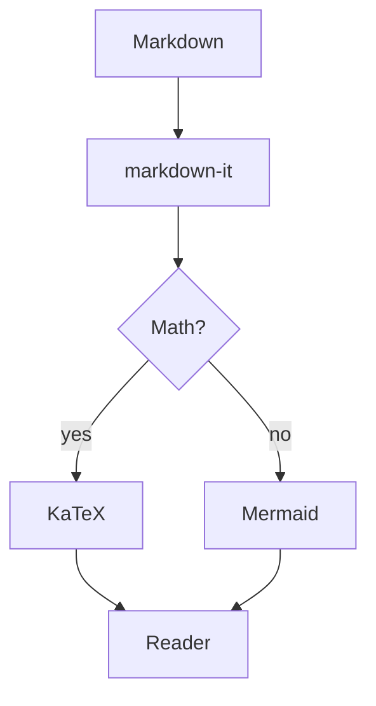

# Reading a structured answer

This sample is our own test document for the VS Code reader. It mixes prose, lists, math,
a diagram, code and a table, the way a long answer from an assistant does.

The reader streams prose in chunks and stops at everything else.

## Lists

- Prose is streamed in short chunks.
- List items are read one by one.
  - Nested items are indented.
- Headings are stops.

1. Open a Markdown file.
2. Run a Speed Read command.

## Math and a diagram

Inline math reads as one unit: the area is $A = \pi r^2$ and the bracket form \(e^{i\pi} + 1 = 0\) works too.

$$
\sum_{k=1}^{n} k = \frac{n(n+1)}{2}
$$

\[
\int_0^1 x^2 \, dx = \frac{1}{3}
\]



The diagram shows how a file becomes the reader's document.

## Code and a table

```ts
export function pivot(word: string): number {
  return Math.floor(word.length / 2);
}
```

| Setting | Default |
|---------|---------|
| Speed   | 300 WPM |
| Chunk   | 3 words |

## Pictures

A local picture: 

A remote picture is never loaded: 

That is the end of the sample.
