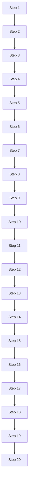

# Wide exhibits

Our own test document for exhibits wider or taller than the exhibit pane.

$$
S = \frac{x_{1}^{2}}{1} + \frac{x_{2}^{2}}{2} + \frac{x_{3}^{2}}{3} + \frac{x_{4}^{2}}{4} + \frac{x_{5}^{2}}{5} + \frac{x_{6}^{2}}{6} + \frac{x_{7}^{2}}{7} + \frac{x_{8}^{2}}{8}
$$

$$
T = \frac{\alpha_{1} x_{1}^{1} + \beta_{1}}{\gamma_{1} + 1} + \frac{\alpha_{2} x_{2}^{2} + \beta_{2}}{\gamma_{2} + 2} + \frac{\alpha_{3} x_{3}^{3} + \beta_{3}}{\gamma_{3} + 3} + \frac{\alpha_{4} x_{4}^{4} + \beta_{4}}{\gamma_{4} + 4} + \frac{\alpha_{5} x_{5}^{5} + \beta_{5}}{\gamma_{5} + 5} + \frac{\alpha_{6} x_{6}^{6} + \beta_{6}}{\gamma_{6} + 6} + \frac{\alpha_{7} x_{7}^{7} + \beta_{7}}{\gamma_{7} + 7} + \frac{\alpha_{8} x_{8}^{8} + \beta_{8}}{\gamma_{8} + 8} + \frac{\alpha_{9} x_{9}^{9} + \beta_{9}}{\gamma_{9} + 9} + \frac{\alpha_{10} x_{10}^{10} + \beta_{10}}{\gamma_{10} + 10} + \frac{\alpha_{11} x_{11}^{11} + \beta_{11}}{\gamma_{11} + 11} + \frac{\alpha_{12} x_{12}^{12} + \beta_{12}}{\gamma_{12} + 12} + \frac{\alpha_{13} x_{13}^{13} + \beta_{13}}{\gamma_{13} + 13} + \frac{\alpha_{14} x_{14}^{14} + \beta_{14}}{\gamma_{14} + 14} + \frac{\alpha_{15} x_{15}^{15} + \beta_{15}}{\gamma_{15} + 15} + \frac{\alpha_{16} x_{16}^{16} + \beta_{16}}{\gamma_{16} + 16} + \frac{\alpha_{17} x_{17}^{17} + \beta_{17}}{\gamma_{17} + 17} + \frac{\alpha_{18} x_{18}^{18} + \beta_{18}}{\gamma_{18} + 18} + \frac{\alpha_{19} x_{19}^{19} + \beta_{19}}{\gamma_{19} + 19} + \frac{\alpha_{20} x_{20}^{20} + \beta_{20}}{\gamma_{20} + 20} + \frac{\alpha_{21} x_{21}^{21} + \beta_{21}}{\gamma_{21} + 21} + \frac{\alpha_{22} x_{22}^{22} + \beta_{22}}{\gamma_{22} + 22}
$$

That is the end.
